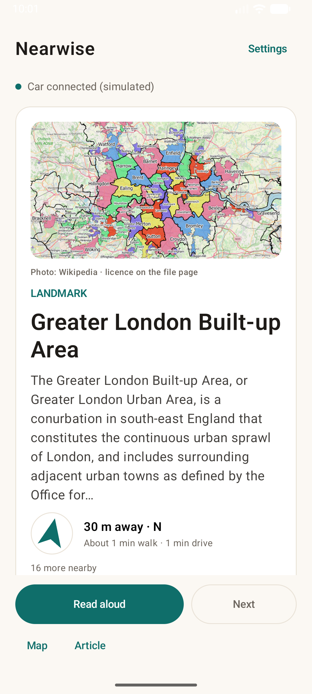
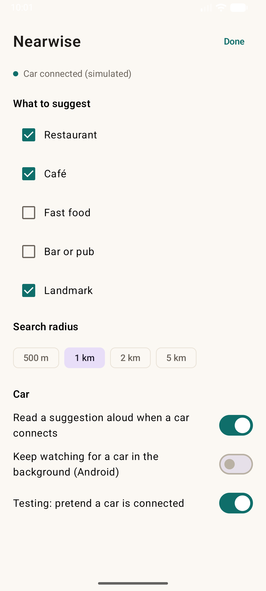
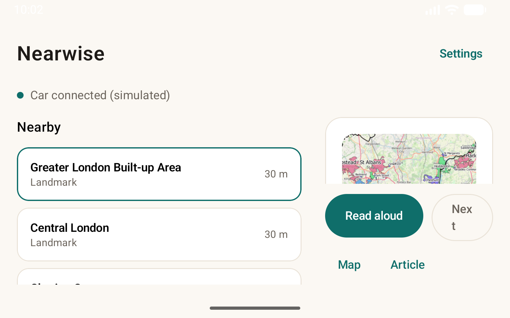
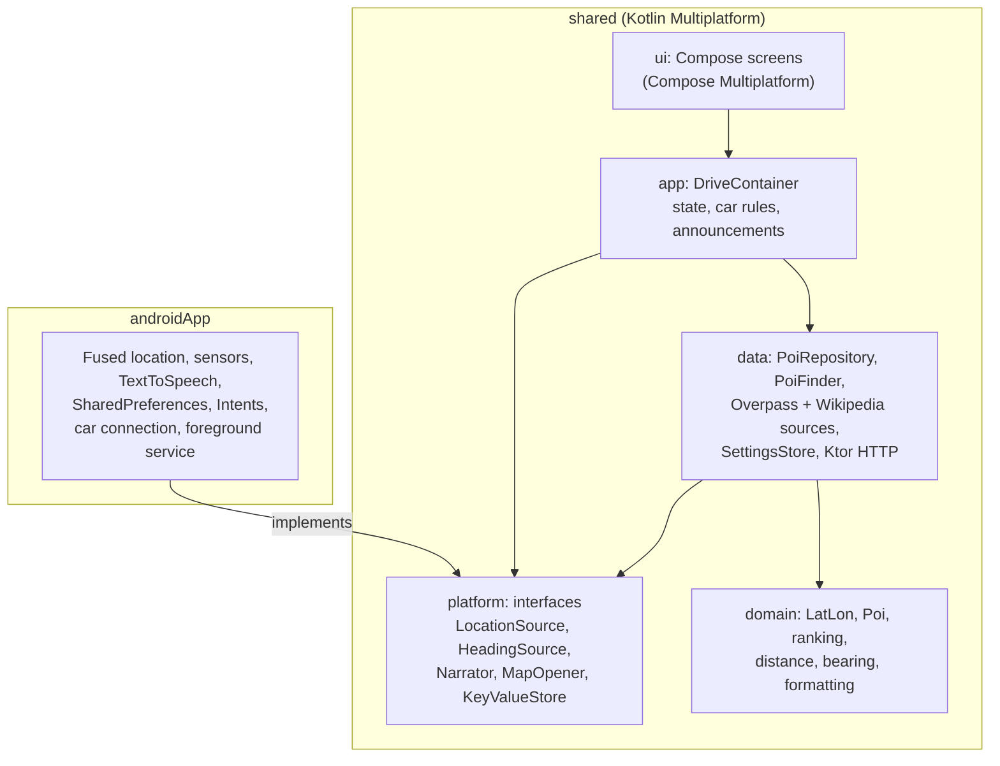

# Near Wise

Near Wise tells you about interesting places close to where you are: a restaurant, a café, a bar, or a landmark with a short read-aloud summary. It works for drivers and for people on foot. It shows the distance, which way the place is, and roughly how long it takes to walk or drive there.



| Settings | Tablet (two panes) |
| --- | --- |
|  |  |

## What it does

- **Nearby suggestions.** Places come from OpenStreetMap (restaurants, cafés, fast food, bars and pubs) and Wikipedia (landmarks). Each one is ranked by how interesting it is, minus a penalty for distance, so a nearby good place can beat a far-away great one.
- **Live distance and direction.** The distance, the compass point, and a pointer arrow update on every GPS fix while the app is on screen. The pointer turns as you turn, using the phone's compass.
- **Walk and drive estimates.** A rough walking time (about 5 km/h) and driving time (about 30 km/h in town). These are estimates, not routing.
- **Photos.** Landmark photos come from Wikipedia at runtime. Nothing is bundled with the app. The credit line links to the image's file page, where its licence is listed.
- **Read aloud.** The top pick can be spoken, ducking music the way navigation prompts do. In a car, the top pick is announced when a car connects and as it changes.
- **Next and dismiss.** Dismissed places are hidden for 12 hours. When nothing is left nearby, the card goes away and a message says so.
- **Settings.** Choose the categories, the search radius (500 m to 5 km), and car behaviour.
- **Layouts.** Phones get one column. Tablets and wide screens get the queue on the left and the suggestion on the right. The action buttons stay pinned at the bottom in both.

## Architecture

The app is one Kotlin codebase in three modules. Platform-specific code sits behind interfaces, so the logic and the screens are shared.



### Data flow

1. `LocationSource.updates()` emits a position on each fix (only while the screen is visible or a car is connected, to save battery).
2. `DriveContainer` passes it to `PoiRepository.onPosition()`. The repository re-ranks the cached places from the new position and publishes a `PoiState`.
3. The Compose UI collects the state, so the card, distance, pointer and queue update together.
4. The places are only fetched again after moving more than 400 m, or when the categories or radius change. Overpass and Wikipedia are queried in parallel, and one failing source does not hide the other.

### Shared code

- **`domain`**: pure Kotlin. Haversine distance, initial bearing, compass points, walk and drive estimates, and the ranking.
- **`data`**: `OverpassSource` (OpenStreetMap), `WikipediaSource` (geosearch, article intros, lead images), `PoiFinder`, `PoiRepository`, and `SettingsStore`. Parsing uses `kotlinx.serialization`. HTTP uses Ktor through one shared client, which sets the timeouts and the User-Agent that Wikimedia requires.
- **`app`**: `DriveContainer` wires everything together and owns the car-connection rules. `ImageLoading.kt` sets up Coil's image loader on the same HTTP client.
- **`ui`**: Compose Multiplatform screens and the theme. Fonts are Compose resources in `shared/src/commonMain/composeResources/font`, so they ship on both platforms.

### Platform code

| Interface | Android |
| --- | --- |
| `LocationSource` | Fused Location Provider |
| `HeadingSource` | Rotation-vector sensor |
| `Narrator` | `TextToSpeech`, with audio focus |
| `MapOpener` | `geo:` intent |
| `KeyValueStore` | `SharedPreferences` |
| Car connection | Car App library `CarConnection` |

## Data sources and licences

- **OpenStreetMap** via the public Overpass API. Data is © OpenStreetMap contributors, licensed under the ODbL. The app must show that attribution in the UI before it is published. This is still to do.
- **Wikipedia** via the MediaWiki API. Article text is licensed under CC BY-SA. Photos are loaded from Wikimedia at runtime. Each image's licence is on its file page, and the credit line links there.
- **Fonts.** Fraunces and Source Sans 3 are licensed under the SIL Open Font License. The licence texts are in `LICENSES/`.

Nothing from these sources is packaged with the app. The app asks for them at runtime.

## Building

Requirements: JDK 17 or newer, the Android SDK (platform 37), and Gradle through the wrapper.

```powershell
.\gradlew.bat :androidApp:assembleDebug        # Android debug APK
.\gradlew.bat :androidApp:testDebugUnitTest    # unit and movement tests
```

Install on an emulator with `adb install -r androidApp\build\outputs\apk\debug\androidApp-debug.apk`. To test the walk, run `scripts\walk-on-emulator.ps1 -Serial emulator-5556` while the app is open. Each step sends a GPS fix, and the cards update as you move.

## Tests

- **Unit tests** for the ranking, distance and bearing maths, Overpass and Wikipedia parsing, the area-article filter, and the photo fields.
- **Movement end-to-end test** (`MovementE2ETest`). It walks from a cafe towards a restaurant in 10 GPS fixes, with fake GPS and a fake network. It checks that the top card switches at the expected point and that the distance follows the walker on each fix. It also checks that dismissing places empties the queue.
- **Integration tests** (`DriveContainerTest`, `PreviousSuggestionTest`). They run the real container and repository with the fake platform. They cover the test location replacing GPS (including live fixes while the screen is on), clearing it, and Back bringing back the last place passed with Next.
- **Settings tests** (`SettingsStoreTest`). The test location is saved and cleared across restarts, and a dismissed place comes back after 12 hours or when undismissed.
- **Screen tests on a device** (`NearwiseScreensTest`, in `androidTest`). They run the real screens: "Read more" opens the modal and Close returns to the card, Back brings back the previous place, system back on Settings returns to the suggestions instead of closing the app, and test mode shows its presets.

The fakes shared by these tests live in `androidApp/src/sharedTest/kotlin`. Run the JVM tests with `.\gradlew.bat :androidApp:testDebugUnitTest`. Run the screen tests on a running emulator or device with `.\gradlew.bat :androidApp:connectedDebugAndroidTest` (set `ANDROID_SERIAL` to pick one device).

## Status

| Area | State |
| --- | --- |
| Android phone and tablet UI | Built and checked on an emulator |
| Live distance, direction and compass pointer | Built and checked on an emulator |
| Wikipedia photos and credit links | Working on an emulator |
| Shared Kotlin code | Android build and tests pass |
| Fonts (Fraunces and Source Sans 3) | Packaged and wired. Rendering on the device not yet confirmed |
| Android Auto car screen | Not built yet |
| OpenStreetMap attribution in the UI | Not built yet |

## Repository layout

```
shared/          Kotlin Multiplatform: domain, data, app, ui, platform interfaces
androidApp/      Android host: Activity, Application, sensors, TTS, car connection
docs/            README screenshots
scripts/         Emulator helpers, such as the walk simulator
LICENSES/        Font licences
```
