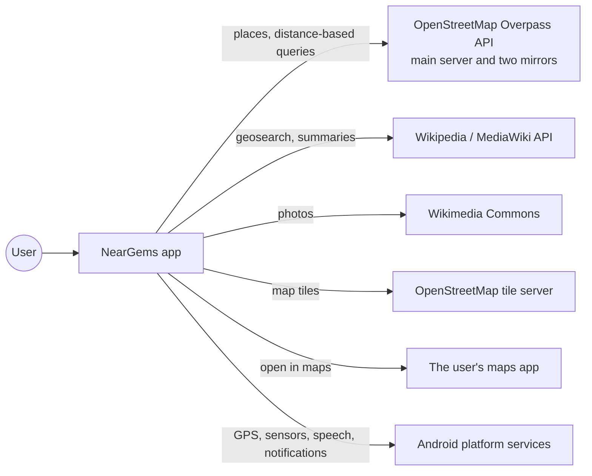
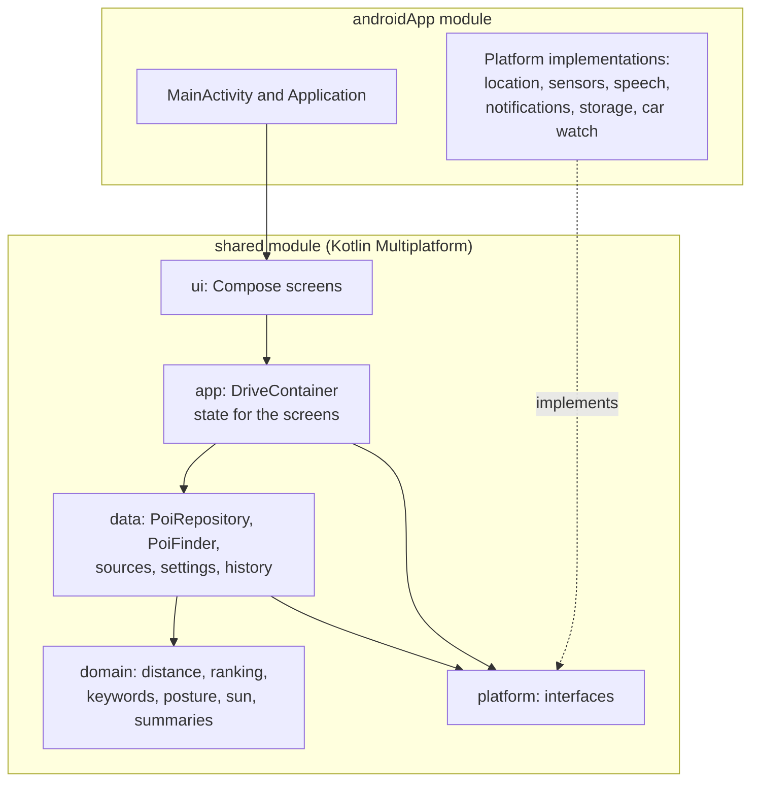

# NearGems: high-level design

NearGems suggests interesting places close to the user: restaurants, cafés, bars, landmarks, and anything the
user names with a keyword. For each place it shows the distance, the compass direction, rough walking and
driving times, a short summary that can be read aloud, a small map, and a photo when one exists.

This document describes what the app does and how its parts fit together. For classes, data formats and
flows in detail, see [low-level-design.md](low-level-design.md).

## Goals

- Show good nearby places quickly, while the user is walking or driving.
- Work with the phone in the hand, mounted in a car, or connected to a car display.
- Keep data on the phone. The developer runs no servers and collects no analytics.
- Use only open data: OpenStreetMap and Wikipedia.
- Run on Android now, with the shared code ready for other platforms.

## Non-goals

- Turn-by-turn routing. Walking and driving times are estimates only.
- Accounts, sign-in, advertising, or analytics.
- Storing where the user has been over time.

## Users and use cases

| Use case | What happens |
| --- | --- |
| Walking around | The card shows the nearest good place, its distance and direction, and a summary to read aloud. Next moves on. |
| Driving with the phone mounted | Places are announced when a car connects, and the pointer follows the direction of travel. |
| Driving with a car display | The same, shown on the car screen (planned, see the roadmap). |
| Looking for a specific kind of place | The user picks categories and types keywords such as "temple" or "lake". |
| Revisiting a place | Places marked as visited are kept in History and can be shown again. |
| Checking the search is alive | A pull-down searches again. A warning shows when a search cannot reach its data. |

## System context

The only network traffic is to these public services, and the phone sends them only the position needed for each
query. Nothing is sent to the developer.

## Major components

- **Domain** holds pure logic with no platform code: distance and bearing, ranking, keyword matching, posture
  classification, the sun's position, and text summaries.
- **Data** fetches and stores places. It talks to the public services and to the device's key-value storage.
- **App** holds the state the screens read, and decides when to search and announce.
- **UI** is one Compose screen tree shared by all sizes: phones, tablets, and landscape.
- **Platform interfaces** isolate everything the device provides. Android implements them; tests use fakes.

## Main flows

### Finding places

1. The phone reports its position (GPS, or a chosen test location).
2. The repository asks the finder for candidates: category searches and keyword searches, each against the main
   Overpass server and its mirrors, plus Wikipedia landmarks.
3. Candidates are ranked by interest, minus a penalty for distance, and filtered to the search radius.
4. The top candidate becomes the current card, and the next ones are queued.
5. A new top place can be read aloud (when audio is on and a car is connected), and a notification shows the
   place on screen.

Results trickle in: each source's answer is shown as soon as it arrives, so the first places appear before the
slowest source finishes.

### Keywords

Keywords add places; they do not filter the chosen categories. A keyword search looks for names that contain the
word anywhere in the search area, and its results sit alongside the category results. Keywords are sent in batches
of eight, and each request is tried up to three times across the Overpass servers.

### Refreshing

- The search repeats when the user moves beyond a set distance, changes a category, radius or keyword, or pulls
  down on the home screen.
- A pull-down forces a fresh search, so new places from the server appear rather than a re-ranking of the old
  ones.
- A warning shows at the top of the home screen when a keyword search could not reach any server.

### Car and posture

- A phone counts as **mounted** when a car display is connected, or when it stays steady while the vehicle moves
  faster than a walking pace. Otherwise it is **hand-held**.
- The phone is **portrait** or **landscape** from gravity.
- When mounted, the pointer follows the direction of travel from GPS; when held, it follows the phone's own heading.
- When a car connects, the top place is announced, and a background watch keeps the app alive if the user has
  turned that on.

### Notifications and speech

- The place on screen stays in the notification shade while the app runs. On Android 16 and later it is a
  promoted live update.
- A new place makes a soft sound, only while audio is on, and never for the first place found at launch.
- Speech uses the phone's own voices. The user can pick one; the list shows the best voice of each accent first.

### History

Places marked as visited are hidden from the cards, stored on the phone with their name, category and location,
and listed in History. From there a place can be shown again or opened in the maps app. A count of visited places
still nearby that match the filters appears on the home screen.

## Data and privacy

- All user data lives in the app's own storage: settings, dismissed and visited places, and the list of seen places.
- Place data and photos are fetched when needed and cached by the image loader.
- Location is sent only to the public services above, as part of each query.
- Clearing the app's data or uninstalling it removes everything the app stores.

## Quality and operations

- The shared logic has unit tests, and the Android screens have device tests run on emulators at several sizes.
- Public Overpass servers are often busy. The app tries the main server and two mirrors, retries with a short
  back-off, batches long keyword lists, and reports a warning when a search cannot be completed.
- Releases are built with the Android Gradle plugin into a signed App Bundle. The signing key is kept outside the
  repository.

## Platforms and roadmap

Today the app runs on Android phones and tablets. Planned work:

- An Android Auto car screen, showing the current place and Next and Back.
- A Wear OS companion, tracked as a separate issue.
- Further mirrors or a self-hosted Overpass server if public servers keep failing.

## Decisions

| Decision | Reason |
| --- | --- |
| Kotlin Multiplatform with Compose | One UI and one set of rules for every screen size, with platform code kept behind small interfaces. |
| OpenStreetMap and Wikipedia | Open, free, and no accounts or keys to manage. |
| Keywords add places rather than filter | A keyword such as "church" should find churches even when no category covers them. |
| Local storage only | The app has no server, so user data never leaves the phone. |
| Mirrors and retries for Overpass | One public server can be busy or rate-limited at any time. |
